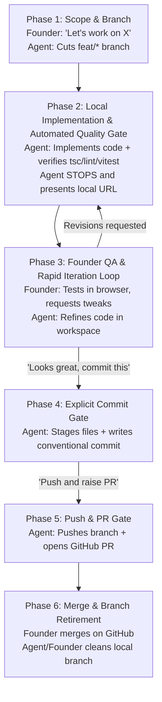

# Satisium Feature Engineering & Collaboration Protocol

> **Contract Reference:** `FEATURE_WORKFLOW.md`  
> **Applicable To:** All Satisium products and workspaces (Ease, Type Studio, ShipOS, etc.)  
> **Core Tenet:** _Zero Autonomous Commits. Founder-Gated Quality. Clean Branch Lifecycle._

---

## 1. Core Philosophy & Role Division

The collaboration model between the **Founder** and the **AI Agent** is strictly defined:

```
┌────────────────────────────────────────────────────────┐
│               FOUNDER (Satishkumar)                    │
│  Product Architect • Design Director • QA Gatekeeper   │
│  Sole Authority to Approve Commits, Pushes & PRs       │
└──────────────────────────┬─────────────────────────────┘
                           │ Directs & Gates
                           ▼
┌────────────────────────────────────────────────────────┐
│               AI AGENT (Antigravity)                   │
│   Senior Software Engineer • Precision Implementer     │
│   Codes • Runs Local Tests • Pauses • Awaits Review    │
└────────────────────────────────────────────────────────┘
```

### Roles Matrix

| Role                           | Key Responsibilities                                                                                                                                                                                                                                                                                       | Authority / Gating                                                                   |
| :----------------------------- | :--------------------------------------------------------------------------------------------------------------------------------------------------------------------------------------------------------------------------------------------------------------------------------------------------------- | :----------------------------------------------------------------------------------- |
| **Founder (`@iamsatish4564`)** | • Defines feature requirements, UX, and aesthetic vision.<br>• Conducts live interactive QA in the browser (`localhost:3000`).<br>• Identifies visual, kinetic, and layout flaws.<br>• **Gatekeeper:** Grants explicit permission for commits, pushes, and PR creation.                                    | **Final Sign-off Authority** on all commits, pushes, and merges.                     |
| **AI Agent (`Antigravity`)**   | • Cuts isolated feature branches from `main`.<br>• Implements code strictly respecting Satisium tokens and contracts.<br>• Runs local typecheck, lint, and test suites.<br>• **Strictly pauses** in the working tree for Founder inspection.<br>• Never performs git commits, pushes, or PRs autonomously. | **Zero Autonomous Git Execution.** Only executes git operations upon direct command. |

---

## 2. The 6-Phase Development Lifecycle

Every feature, bug fix, or refactor follows this linear, gated cycle without exception:



---

### Phase 1: Scope & Branch Initialization

1. **Trigger:** Founder specifies a task or says _"Let's work on [feature/fix]"_.
2. **Agent Responsibilities:**
   - Verify working tree is clean: `git status`.
   - Ensure local `main` is current: `git checkout main && git pull origin main`.
   - Create a clean local feature branch:
     - `feat/<feature-slug>` for new capabilities (e.g. `feat/stage-1-resizable-theater`).
     - `fix/<fix-slug>` for bug fixes (e.g. `fix/previewer-vertical-centering`).
   - Outline the concise implementation blueprint and affected files.
   - **Do not make any git commits.**

---

### Phase 2: In-Workspace Implementation & Automated Quality Gate

1. **Agent Responsibilities:**
   - Code the changes in the working tree.
   - Strictly adhere to Satisium non-negotiables:
     - Tokens only (no hardcoded hex/rgb).
     - Zero opacity modifiers on colors (use discrete semantic tokens like `bg-muted`, `bg-secondary`).
     - Routes via `lib/routes.ts`, navigation via `lib/nav.ts`.
     - Springs and easings via `lib/motion.ts`.
   - Run automated verification:
     ```bash
     pnpm typecheck   # zero TypeScript errors
     pnpm lint        # zero ESLint errors
     pnpm test        # all vitest suites pass
     ```
2. **Agent Hard Stop (MANDATORY):**
   - **ZERO Git Operations.** Do NOT run `git commit`, `git push`, or `gh pr create`.
   - Hand over to the Founder:
     > _"Implementation complete and passes local typecheck/lint/tests. Live at `http://localhost:3000/<route>`. Please inspect in your browser."_

---

### Phase 3: Founder Interactive QA & Refinement Loop

1. **Founder Responsibilities:**
   - Open the live dev server in the browser.
   - Test layout, responsive behavior, click/drag mechanics, physics, and visual centering.
   - Provide direct, unfiltered feedback (e.g., _"Button is stuck at the top, center it"_ or _"Resize handle should match docs"_).
2. **Agent Responsibilities:**
   - Apply edits directly to the files in the workspace.
   - Confirm when changes are hot-reloaded and verified.
   - Repeat until the Founder is 100% satisfied.

---

### Phase 4: Explicit Commit Gate (Founder Gated)

1. **Trigger:** The Founder explicitly commands:
   - _"Looks great, commit this."_
   - _"Commit these changes with message '...'."_
2. **Agent Responsibilities:**
   - Stage only the relevant modified files (`git add <file1> <file2>`).
   - Create a single, atomic conventional commit:
     - `feat(scope): concise imperative description`
     - `fix(scope): concise imperative description`
   - Output the commit hash and status.
   - **STILL DO NOT PUSH.**

---

### Phase 5: Push & PR Gate (Founder Gated)

1. **Trigger:** The Founder explicitly commands:
   - _"Push and open a PR."_
   - _"Raise the PR to main."_
2. **Agent Responsibilities:**
   - Push the feature branch to GitHub:
     ```bash
     git push -u origin <branch-name>
     ```
   - Create the Pull Request via `gh pr create` with:
     - Title formatted according to conventional commits.
     - Summary of changes, architectural notes, and verification checklist.
   - Output the live PR link for the Founder.

---

### Phase 6: Merge & Branch Retirement Protocol

1. **Founder Action:**
   - Reviews the PR on GitHub.
   - Merges the PR into `main` (Squash & Merge or Rebase).
   - Clicks **"Delete branch"** on GitHub to remove `origin/<branch-name>`.
2. **Local Workspace Cleanup (Agent or Founder):**
   ```bash
   git checkout main
   git pull origin main
   git branch -d feat/<branch-name>
   git fetch -p
   ```
3. **Outcome:**
   - Local workspace is back on `main` with all changes incorporated.
   - Stale feature branches are deleted both locally and remotely.
   - Ready for Phase 1 of the next feature.

---

## 3. Strict Non-Negotiable Invariants

| Invariant                                   | Rule                                                                                                                                               |
| :------------------------------------------ | :------------------------------------------------------------------------------------------------------------------------------------------------- |
| 🔒 **Zero Autonomous Git Operations**       | Never commit, push, or open a PR without an explicit command from the Founder.                                                                     |
| 🔒 **The Browser is the Source of Truth**   | Passing automated tests (`tsc`, `lint`, `test`) is the technical baseline, but visual and interaction QA by the Founder is the mandatory sign-off. |
| 🔒 **No Commits to `main`**                 | All active work occurs on isolated `feat/*` or `fix/*` branches.                                                                                   |
| 🔒 **Tokens Only & Zero Opacity Modifiers** | Never use arbitrary tailwind opacity hacks (e.g. `bg-primary/80`). Use discrete semantic tokens.                                                   |
| 🔒 **Kit & Docs Preservation**              | Never delete template variants, catalog primitives, or docs files during feature work.                                                             |

---

## 4. Quick-Reference Command Table

| Action                          | Command                                                                               |
| :------------------------------ | :------------------------------------------------------------------------------------ |
| **Start Feature Branch**        | `git checkout main && git pull origin main && git checkout -b feat/<name>`            |
| **Verify Local Quality**        | `pnpm typecheck && pnpm lint && pnpm test`                                            |
| **Commit (When instructed)**    | `git add <files> && git commit -m "feat(<scope>): description"`                       |
| **Push & PR (When instructed)** | `git push -u origin <branch> && gh pr create --base main`                             |
| **Clean Up After Merge**        | `git checkout main && git pull origin main && git branch -d <branch> && git fetch -p` |
