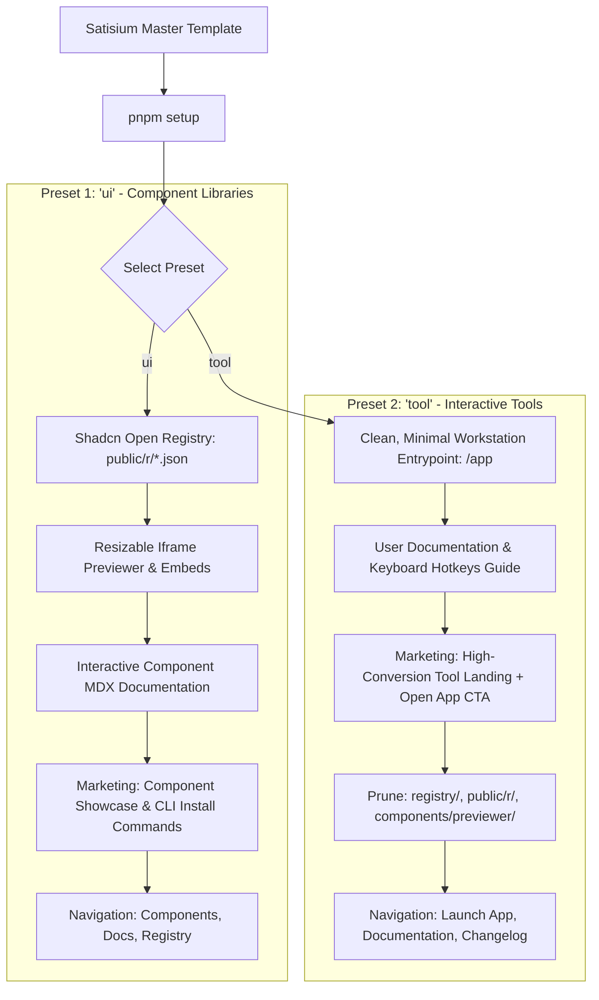
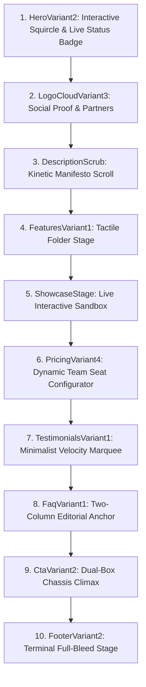
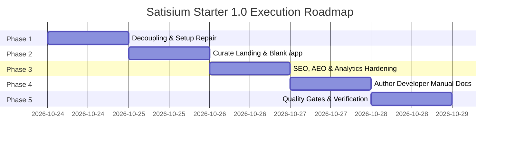

# Satisium Starter — Master Production Readiness Plan & Architecture Report

> **Version:** 1.0.0-draft  
> **Status:** Execution Blueprint  
> **Authority:** Satisium Core Architecture Team  
> **Last Updated:** October 2026

---

## Table of Contents

1. [Executive Summary & Quality Baseline](#1-executive-summary--quality-baseline)
   - 1.1 Purpose & Mandate
   - 1.2 Diagnostic Audit Scorecard (65/100 to 95/100 Target)
   - 1.3 Architectural Invariants & Non-Negotiables
2. [The Two-Preset Architecture (`ui` vs `tool`)](#2-the-two-preset-architecture-ui-vs-tool)
   - 2.1 Strategic Rationale: Two Focused Golden Presets
   - 2.2 Preset 1: `ui` (Component Library & Open Registry)
   - 2.3 Preset 2: `tool` (Interactive Web App & Canvas Workstation)
   - 2.4 Decoupled Architecture & Zero-Crash Pruning
3. [Developer Experience (DX) & Scaffolding Engine](#3-developer-experience-dx--scaffolding-engine)
   - 3.1 The 60-Second Onboarding Journey
   - 3.2 Repairing `scripts/init-project.mjs`
   - 3.3 Dynamic Navigation & Route Synchronization (`lib/nav.ts` & `lib/routes.ts`)
   - 3.4 Command Line Hygiene & Doctor Alias
4. [The Product Workstation Space (`/app`)](#4-the-product-workstation-space-app)
   - 4.1 The Blank Slate Mandate
   - 4.2 Shell & Layout Integration (`AppShell`, `SiteHeader`)
   - 4.3 Tool Extension Points & Clean Scaffolding
5. [Marketing Landing Page Architecture (`/`)](#5-marketing-landing-page-architecture-)
   - 5.1 Resolving Prototype Bloat (Duplicate Section Pruning)
   - 5.2 The Unified Marketing Flow
   - 5.3 Design Variant Sandbox (`/stage`)
6. [Analytics, Telemetry & Consent Architecture](#6-analytics-telemetry--consent-architecture)
   - 6.1 The Unified `trackEvent` Facade
   - 6.2 Standardized Event Taxonomy
   - 6.3 Privacy Compliance & Cookie Preferences Trigger
   - 6.4 Core Web Vitals (CWV) Telemetry
7. [SEO, Metadata & OpenGraph Engine](#7-seo-metadata--opengraph-engine)
   - 7.1 Single Source of Truth Configuration (`config/site.ts`)
   - 7.2 Dynamic Social Sharing Cards (`/api/og`)
   - 7.3 High-Fidelity Sitemap (`app/sitemap.ts`)
   - 7.4 Structured Data (Schema.org Rich Entities)
8. [AEO (AI Engine Optimization & LLM Readiness)](#8-aeo-ai-engine-optimization--llm-readiness)
   - 8.1 Dedicated AI Bot Directives (`app/robots.ts`)
   - 8.2 The Automated Knowledge Base Pipeline (`pnpm llm`)
   - 8.3 In-Head Discovery Link Elements
9. [Documentation Engine & Developer Manual (`/docs`)](#9-documentation-engine--developer-manual-docs)
   - 9.1 Fumadocs MDX Infrastructure
   - 9.2 The Getting Started Documentation Suite
   - 9.3 Component Kit Documentation Roadmap (`content/docs/kit/`)
10. [The 5-Minute Post-Setup Customization Checklist](#10-the-5-minute-post-setup-customization-checklist)
    - 10.1 Asset Replacement Map
    - 10.2 Social & Profile Bindings
    - 10.3 Production Deployment Steps
11. [Phased Execution Roadmap & Verification Checkpoints](#11-phased-execution-roadmap--verification-checkpoints)
    - Phase 1: Decoupling & Scaffolder Repair
    - Phase 2: Landing Page Curation & Clean `/app` Entrypoint
    - Phase 3: SEO, AEO & Analytics Hardening
    - Phase 4: Author the Developer Manual Guides
    - Phase 5: Verification & Quality Gates
12. [Definition of Done & Acceptance Criteria](#12-definition-of-done--acceptance-criteria)

---

## 1. Executive Summary & Quality Baseline

### 1.1 Purpose & Mandate

The **Satisium Starter** is designed as the master foundation for all digital products, interactive tools, and web applications built under the Satisium Umbrella. It bridges the divide between marketing surfaces, product application workstations (`/app`), and comprehensive documentation (`/docs`) within a single, cohesive codebase.

By unifying design tokens, font definitions, keyboard shortcuts (⌘K), and brand aesthetics, the starter enables engineers to launch new products rapidly without re-architecting foundational infrastructure.

### 1.2 Diagnostic Audit Scorecard

An in-depth review of the current codebase reveals a strong visual foundation paired with critical gaps in the developer workflow and template scaffolding:

| Category                               | Baseline Score | Production Target | Key Finding                                                              |
| :------------------------------------- | :------------: | :---------------: | :----------------------------------------------------------------------- |
| **1. Design System & Tokens**          |  **9.0 / 10**  |     9.5 / 10      | OKLCH luminance scale, zero-shadow depth, custom brand fonts.            |
| **2. Command Palette (⌘K) & Nav**      |  **8.5 / 10**  |     9.5 / 10      | Unified palette covers docs and quick actions cleanly.                   |
| **3. Performance & Web Vitals**        |  **8.0 / 10**  |     9.0 / 10      | Next.js 16 Turbopack, local font display swap, zero render-blocking CSS. |
| **4. Documentation Engine (Fumadocs)** |  **7.5 / 10**  |     9.5 / 10      | Dual-layout (spatial/three-pane); needs decoupled previewer imports.     |
| **5. SEO, Metadata & OpenGraph**       |  **6.5 / 10**  |     9.5 / 10      | Dynamic OG route exists; sitemap has dynamic timestamp bug.              |
| **6. Analytics, Telemetry & Consent**  |  **6.5 / 10**  |     9.0 / 10      | Multi-provider skeleton present; needs unified `trackEvent` dispatcher.  |
| **7. Marketing Landing Page**          |  **6.0 / 10**  |     9.5 / 10      | High-quality components, but bloated with 4 stacked feature variants.    |
| **8. AEO & LLM Readiness**             |  **6.0 / 10**  |     9.5 / 10      | `build-llms.mjs` generates artifacts, but hardcodes fallback domains.    |
| **9. Scaffolding & Preset DX**         |  **4.0 / 10**  |     9.5 / 10      | `pnpm setup` crashes; preset pruning breaks TypeScript build.            |
| **10. Product Workstation (`/app`)**   |  **3.0 / 10**  |     9.5 / 10      | Stripped to raw text placeholder; needs clean, structured entrypoint.    |
| **TOTAL SCORE**                        |  **65 / 100**  |   **94+ / 100**   | **Grade: C+ → Target: A+**                                               |

### 1.3 Architectural Invariants & Non-Negotiables

All implementations across the starter must strictly uphold the core Satisium contract:

1. **The Zero-Key Rule:** The repository must boot (`pnpm dev`), build (`pnpm build`), and pass tests (`pnpm test`) with an empty `.env.local`. Missing third-party API keys must safely degrade to no-ops.
2. **Tokens Only:** Zero hardcoded hex colors, rgb values, or Tailwind raw grays (`text-gray-500`). All styles use semantic tokens (`bg-background`, `bg-muted`, `text-foreground`, `text-muted-foreground`, `border-border`).
3. **Zero Opacity Modifiers:** Never use slash opacity modifiers on colors (e.g., `bg-primary/20`, `text-muted-foreground/80`). Use discrete semantic variables and surface tokens directly to avoid substrate bleed and luminosity shifts.
4. **Typed Route Integrity:** Every internal route must reference `ROUTES` from `lib/routes.ts`. Literal string paths (`href="/app"`) are forbidden in UI components.
5. **Centralized Navigation:** All navigation trees read directly from `lib/nav.ts`.
6. **Strict Motion Standards:** All transition curves and spring physics must be sourced from `lib/motion.ts`. Inlining raw stiffness or damping numbers is disallowed.
7. **Production Cleanliness:** No `any`, no `as unknown as`, no commented-out code blocks, and no raw `console.log` statements (use `lib/logger.ts`).

---

## 2. The Two-Preset Architecture (`ui` vs `tool`)



### 2.1 Strategic Rationale: Two Focused Golden Presets

Instead of complicating the starter with four theoretical presets (`library`, `tool`, `saas`, `landing`) that partially overlap, the template standardizes on two clear, production-grade archetypes:

- **`ui`:** Tailored for design systems, reusable UI kits, and distributable component libraries (e.g., Satisium Pro UI).
- **`tool`:** Tailored for interactive web utilities, productivity tools, and application canvases (e.g., Tweak, Typeset).

### 2.2 Preset 1: `ui` (Component Library & Open Registry)

- **What it keeps:**
  - Full Shadcn Open Registry compilation (`registry/**`, `public/r/*.json`, `registry.json`).
  - Registry build pipelines: `pnpm build:registry:meta` and `pnpm registry:public`.
  - Live interactive previewer engine (`components/previewer/**`, `app/preview/[registryKey]`, `app/embed/[registryKey]`).
  - Fumadocs component documentation with live preview tabs, props description lists, and "Copy CLI" / "Copy MDX" action buttons.
  - Marketing landing page configured to showcase component designs and installation commands.
  - Navigation links highlighting: **Components**, **Documentation**, and **Registry**.
  - `/app` page retained as a minimal entrypoint.

### 2.3 Preset 2: `tool` (Interactive Web App & Canvas Workstation)

- **What it keeps:**
  - Clean, blank `/app` workstation entrypoint wrapped in the Satisium shell, ready for immediate tool feature development.
  - Product documentation focused on onboarding, usage guides, and keyboard shortcuts (`content/docs/getting-started/**`, `hotkeys.mdx`).
  - High-conversion landing page focused on product capabilities, interactive sandbox, and direct `Open App →` action triggers.
  - Navigation links highlighting: **Launch App**, **Documentation**, and **Changelog**.
- **What it prunes:**
  - `registry/` directory and compiled schemas in `public/r/`.
  - Component previewer suite (`components/previewer/`, `app/preview/`, `app/embed/`).
  - Registry demo components in `content/docs/components/`.

### 2.4 Decoupled Architecture & Zero-Crash Pruning

- **Current Flaw:** `app/docs/[[...slug]]/page.tsx` and `lib/docs-page.tsx` directly import `ComponentPreviewer` from `@/components/previewer/component-preview`. If the previewer is pruned, the TypeScript compiler fails with `Module not found`.
- **The Solution:** Decouple the previewer using an optional adapter component (`components/docs/doc-demo-renderer.tsx`). If the previewer directory exists, it dynamically mounts the interactive canvas; if pruned, it renders a clean code block fallback without throwing a build error.

---

## 3. Developer Experience (DX) & Scaffolding Engine

### 3.1 The 60-Second Onboarding Journey

When initiating a new building session, the developer executes:

```bash
# 1. Clone template into new product workspace
git clone https://github.com/satisium/starter.git my-app
cd my-app

# 2. Install dependencies
pnpm install

# 3. Brand and prune the workspace
pnpm setup
```

The interactive CLI will prompt:

```text
✦ Satisium Product Scaffolder ✦

? Product Name: Tweak
? Production Domain (https://...): https://tweak.satisium.com
? Select Preset:
  ❯ 1. tool — Interactive Workstation Canvas + Product Docs (Tweak, Typeset)
    2. ui   — Component Library + Shadcn Registry + Live Previewer (Satisium Pro UI)

✔ Updated config/site.ts with "Tweak" and "https://tweak.satisium.com"
✔ Pruned unused modules for preset [tool]
✔ Synchronized navigation in lib/nav.ts and lib/routes.ts
✔ Recompiled llms.txt and sitemap
✔ Architectural Doctor: 13/13 Checks Passed

🚀 Tweak is ready! Run `pnpm dev` to start building.
```

### 3.2 Repairing `scripts/init-project.mjs`

1. **Target Single Source of Truth:** Update the script to modify `config/site.ts` (`PRODUCT.name`, `PRODUCT.shortName`, `PRODUCT.defaultTitle`, `PRODUCT.titleTemplate`, `PROJECT.name`, `REPO`, `AUTHOR`) rather than `lib/config.ts`.
2. **Atomic Synchronization:** Synchronize `package.json` (`name: slug`), `.env.example` (`NEXT_PUBLIC_SITE_URL`), and `scripts/build-llms.mjs`.
3. **Execution Guard:** Create `.starter-initialised` to prevent accidental re-runs on a modified codebase.

### 3.3 Dynamic Navigation & Route Synchronization (`lib/nav.ts` & `lib/routes.ts`)

- If the `tool` preset is chosen:
  - Remove `ROUTES.docsComponents` and `ROUTES.docsSample` from `lib/routes.ts`.
  - Prune the "Components" navigation item from `APP_NAV`, `FOOTER_NAV`, and `QUICK_ACTIONS` in `lib/nav.ts`.
- If the `ui` preset is chosen:
  - Retain all component registry routes and preview links.

### 3.4 Command Line Hygiene & Doctor Alias

- In `package.json`, pnpm intercepts `pnpm doctor` with its internal package manager checker.
- **Fix:** Add a dedicated script alias in `package.json`:
  ```json
  "check:doctor": "node scripts/doctor.mjs"
  ```
  This guarantees that typing `pnpm check:doctor` executes the 13-point Satisium architectural contract check.

---

## 4. The Product Workstation Space (`/app`)

### 4.1 The Blank Slate Mandate

Per product requirements, the `/app` page must **remain clean, minimal, and blank**. It must avoid forcing developers to delete extensive mock tasks, complex demo data, or domain-specific dashboards before building.

### 4.2 Shell & Layout Integration (`AppShell`, `SiteHeader`)

[app/app/page.tsx](file:///home/satishkumar/Desktop/The%20Satisium%20Umbrella/starter-template/app/app/page.tsx) will be structured as:

```tsx
import type { Metadata } from "next"
import { AppShell } from "@/components/layout/app-shell"
import { SiteHeader } from "@/components/layout/site-header"
import { AppNav } from "@/components/layout/app-nav"
import { APP_NAV } from "@/lib/nav"
import { PRODUCT } from "@/lib/config"
import { buildMetadata } from "@/lib/metadata"
import { ROUTES } from "@/lib/routes"

export const metadata = buildMetadata({
  title: "App",
  description: `The ${PRODUCT.name} workstation.`,
  path: ROUTES.app,
})

export default function AppPage() {
  return (
    <AppShell
      header={<SiteHeader />}
      rail={<AppNav items={APP_NAV} />}
      contained
    >
      <main className="flex min-h-[calc(100vh-8rem)] w-full flex-col items-center justify-center rounded-3xl border border-dashed border-border bg-card p-12 text-center">
        <h1 className="font-heading text-lg font-medium text-muted-foreground sm:text-xl">
          Start building your product canvas here
        </h1>
        <p className="mt-2 text-xs text-muted-foreground">
          Import your canvas, workspace controls, or tool state machine.
        </p>
      </main>
    </AppShell>
  )
}
```

### 4.3 Tool Extension Points & Clean Scaffolding

- Provides a dashed, responsive canvas bounding box.
- Retains the global site header, breadcrumbs, theme switcher bloom, and ⌘K search trigger.
- Ready for immediate import of tool state (Zustand), SVG manipulation, or canvas logic.

---

## 5. Marketing Landing Page Architecture (`/`)

### 5.1 Resolving Prototype Bloat (Duplicate Section Pruning)

Currently, [app/page.tsx](file:///home/satishkumar/Desktop/The%20Satisium%20Umbrella/starter-template/app/page.tsx) renders **4 sets of feature sections, 2 sets of testimonials, 2 sets of FAQs, and 2 sets of CTAs** simultaneously. This creates massive DOM bloat and confusion for template users.

### 5.2 The Unified Marketing Flow

The root landing page will be curated into a single, high-converting product narrative:



### 5.3 Design Variant Sandbox (`/stage`)

All secondary variants (`FeaturesVariant2/3/4`, `TestimonialsVariant2`, `FaqVariant2`, `CtaVariant3`) are preserved in [app/stage/page.tsx](file:///home/satishkumar/Desktop/The%20Satisium%20Umbrella/starter-template/app/stage/page.tsx) as an interactive design sandbox, allowing developers to preview and swap layout variants easily.

---

## 6. Analytics, Telemetry & Consent Architecture

### 6.1 The Unified `trackEvent` Facade

All event tracking is routed through a single, safe utility function in [lib/analytics.ts](file:///home/satishkumar/Desktop/The%20Satisium%20Umbrella/starter-template/lib/analytics.ts):

```ts
import { logger } from "@/lib/logger"
import { hasConsent } from "@/lib/consent-utils"
import posthog from "posthog-js"

export async function trackEvent(
  eventName: string,
  properties?: Record<string, unknown>,
  incrementPublicCounter?: "web_copy" | "page_view"
) {
  // 1. Upstash Redis Telemetry Counter (Zero-key fallback in memory)
  if (incrementPublicCounter) {
    try {
      await fetch("/api/telemetry", {
        method: "POST",
        headers: { "Content-Type": "application/json" },
        body: JSON.stringify({
          action: incrementPublicCounter,
          component: properties?.component || properties?.file || "unknown",
        }),
        keepalive: true,
      })
    } catch (e) {
      logger.error("Telemetry increment failed:", e)
    }
  }

  // 2. Cookie Consent Enforcement
  if (!hasConsent()) return

  // 3. PostHog Event Dispatch
  if (
    typeof window !== "undefined" &&
    process.env.NEXT_PUBLIC_POSTHOG_PROJECT_TOKEN
  ) {
    posthog.capture(eventName, properties)
  }

  // 4. Google Analytics Dispatch
  if (
    typeof window !== "undefined" &&
    window.gtag &&
    process.env.NEXT_PUBLIC_GA_ID
  ) {
    window.gtag("event", eventName, properties)
  }
}
```

### 6.2 Standardized Event Taxonomy

The starter defines and implements events for core user interactions:

- `cta_click` — Triggered when hero or marketing CTA buttons are clicked.
- `command_copy` — Triggered when copying CLI install or code blocks.
- `theme_toggle` — Triggered on light/dark mode switch.
- `command_menu_open` — Triggered on ⌘K palette invocation.
- `doc_search` — Triggered on documentation search query.

### 6.3 Privacy Compliance & Cookie Preferences Trigger

- **Consent Persistence:** Handled in `lib/consent.tsx` with local storage caching.
- **Footer Trigger:** Wire the "Cookie Settings" link in the footer to open a lightweight preference dialog, allowing users to modify or revoke consent at any time.

### 6.4 Core Web Vitals (CWV) Telemetry

- [components/web-vitals.tsx](file:///home/satishkumar/Desktop/The%20Satisium%20Umbrella/starter-template/components/web-vitals.tsx) monitors `LCP`, `INP`, `CLS`, `FID`, and `TTFB` via `next/web-vitals`, reporting metrics to PostHog when analytics are enabled.

---

## 7. SEO, Metadata & OpenGraph Engine

### 7.1 Single Source of Truth Configuration (`config/site.ts`)

All product metadata, social profiles, and author information derive from [config/site.ts](file:///home/satishkumar/Desktop/The%20Satisium%20Umbrella/starter-template/config/site.ts). Non-docs routes utilize `buildMetadata()` from [lib/metadata.ts](file:///home/satishkumar/Desktop/The%20Satisium%20Umbrella/starter-template/lib/metadata.ts) for automatic canonical tags, OpenGraph cards, and Twitter summaries.

### 7.2 Dynamic Social Sharing Cards (`/api/og`)

- **Endpoint:** `/api/og?title=<Title>&label=<Category>`
- Driven by `ImageResponse` from `next/og` on the Node.js runtime.
- Reads `public/PlusJakartaSans-Bold.ttf` for consistent, crisp typography.
- Overlay composition: Dark void (`#090909`), rounded border clip (`36px`), brand flame background (`public/og-bg-optimized.jpg`), and product logo (`public/satisium.png`).
- Docs pages automatically call this route with their own page titles.

### 7.3 High-Fidelity Sitemap (`app/sitemap.ts`)

- **The Bug:** Currently returns `lastModified: new Date()` on every call, destroying crawler caching.
- **The Fix:** Replace with git commit timestamps or a static `updated` date from `config/site.ts`:
  ```ts
  export default async function sitemap(): Promise<MetadataRoute.Sitemap> {
    const launchDate = new Date("2026-01-01T00:00:00Z")
    const docUrls = source.getPages().map((page) => ({
      url: `${SITE_URL}${page.url}`,
      lastModified: launchDate,
      changeFrequency: "weekly" as const,
      priority: 0.8,
    }))

    return [
      {
        url: SITE_URL,
        lastModified: launchDate,
        changeFrequency: "daily",
        priority: 1.0,
      },
      {
        url: `${SITE_URL}/app`,
        lastModified: launchDate,
        changeFrequency: "weekly",
        priority: 0.9,
      },
      ...docUrls,
    ]
  }
  ```

### 7.4 Structured Data (Schema.org Rich Entities)

- Root layout injects JSON-LD for:
  - `WebSite` (with search action target)
  - `Organization` (with social links and brand logo)
  - `WebPage`
- Landing page injects `BreadcrumbList`.
- `/app` workstation injects `SoftwareApplication` schema.
- Documentation pages inject `TechArticle` schema.

---

## 8. AEO (AI Engine Optimization & LLM Readiness)

### 8.1 Dedicated AI Bot Directives (`app/robots.ts`)

Configure [app/robots.ts](file:///home/satishkumar/Desktop/The%20Satisium%20Umbrella/starter-template/app/robots.ts) to explicitly permit AI indexers:

```ts
export default function robots(): MetadataRoute.Robots {
  return {
    rules: [
      {
        userAgent: "*",
        allow: ["/", "/llms.txt", "/llms-full.txt", "/llms/"],
        disallow: ["/api/", "/embed/", "/preview/"],
      },
      {
        userAgent: [
          "GPTBot",
          "ClaudeBot",
          "PerplexityBot",
          "Google-Extended",
          "Applebot-Extended",
        ],
        allow: ["/", "/llms.txt", "/llms-full.txt", "/llms/"],
        disallow: ["/api/", "/embed/", "/preview/"],
      },
    ],
    sitemap: `${SITE_URL}/sitemap.xml`,
  }
}
```

### 8.2 The Automated Knowledge Base Pipeline (`pnpm llm`)

- Script: [scripts/build-llms.mjs](file:///home/satishkumar/Desktop/The%20Satisium%20Umbrella/starter-template/scripts/build-llms.mjs)
- **The Fix:** Import `SITE_URL` and `PRODUCT.name` directly from `config/site.ts` to prevent broken `https://your-domain.com` fallbacks.
- Generates:
  1. `public/llms.txt` — The structured directory AI models query first.
  2. `public/llms-full.txt` — The complete documentation concatenated for 1-shot context injection.
  3. `public/llms/*.md` — Individual clean markdown representations of each MDX doc page.

### 8.3 In-Head Discovery Link Elements

Root layout includes discovery metadata in the HTML `<head>`:

```html
<link rel="alternate" type="application/llms+txt" href="/llms.txt" />
<link rel="alternate" type="text/markdown" href="/llms-full.txt" />
```

---

## 9. Documentation Engine & Developer Manual (`/docs`)

### 9.1 Fumadocs MDX Infrastructure

- Powered by Fumadocs Core and MDX with Shiki syntax highlighting.
- Supports dual layouts: `spatial` (signature Satisium card-shift) and `three-pane` (classic borderless sidebar, reading measure article, and contextual third rail).
- Integrated with the global ⌘K command menu for live documentation search.

### 9.2 The Getting Started Documentation Suite

The `content/docs/getting-started/` directory will be expanded with four comprehensive guides:

```
content/docs/getting-started/
├── installation.mdx       # Step 1: Clone, pnpm install, pnpm setup, zero-key boot
├── presets.mdx            # Step 2: In-depth breakdown of 'ui' vs 'tool' presets
├── configuration.mdx      # Step 3: Brand tokens, site.ts, assets, and environment keys
├── analytics.mdx          # Step 4: trackEvent, PostHog, GA, and cookie consent rules
└── seo-and-aeo.mdx        # Step 5: Dynamic OG social cards, robots.txt, and llms.txt
```

### 9.3 Component Kit Documentation Roadmap (`content/docs/kit/`)

Create documentation boilerplate under `content/docs/kit/` covering the template's primary UI primitives:

- `action-button.mdx`
- `stat-card.mdx`
- `empty-state.mdx`
- `kbd.mdx`
- `input-group.mdx`

---

## 10. The 5-Minute Post-Setup Customization Checklist

After executing `pnpm setup`, developers only need to review four specific files to finalize branding:

| Step                     | File / Asset                                                | Responsibility                          | Default Provided                         |
| :----------------------- | :---------------------------------------------------------- | :-------------------------------------- | :--------------------------------------- |
| **1. Browser Icons**     | `app/icon.svg`<br>`app/apple-icon.png`<br>`app/favicon.ico` | Tab glyph & mobile bookmark icon        | Geometric Satisium mark                  |
| **2. Dynamic OG Banner** | `public/og-bg-optimized.jpg`<br>`public/satisium.png`       | 1200×630 background & 512×512 logo mark | Dark void flame canvas & brand mark      |
| **3. Social Handles**    | `config/site.ts` (`PROJECT` & `AUTHOR`)                     | X, GitHub, Discord links in footer & ⌘K | Satisium community channels              |
| **4. Workstation Logic** | `app/app/page.tsx`                                          | Main product interface                  | Clean, blank slate ready for development |

---

## 11. Phased Execution Roadmap & Verification Checkpoints



### Phase 1: Decoupling & Setup Repair

- Decouple `components/previewer` in `app/docs` via an optional component adapter.
- Update `scripts/init-project.mjs` to target `config/site.ts` and handle `ui` and `tool` presets.
- Add `"check:doctor": "node scripts/doctor.mjs"` to `package.json`.
- **Validation:** Run `pnpm typecheck` and test `pnpm setup` with a mock run.

### Phase 2: Landing Page Curation & Clean `/app` Entrypoint

- Streamline `app/page.tsx` to the single curated marketing flow.
- Verify alternative variants remain accessible in `app/stage/page.tsx`.
- Re-mount `<AppShell>`, `<SiteHeader>`, `<AppNav>` in `app/app/page.tsx` with a clean, blank canvas.
- **Validation:** Verify `/` and `/app` visually render without warnings.

### Phase 3: SEO, AEO & Analytics Hardening

- Fix `app/sitemap.ts` to use static launch dates.
- Update `app/robots.ts` with dedicated AI crawler user agents.
- Fix domain resolution in `scripts/build-llms.mjs`.
- Unify `trackEvent` across PostHog, Google Analytics, and the Redis counter in `lib/analytics.ts`.
- **Validation:** Run `pnpm llm` and verify `public/llms.txt` URLs.

### Phase 4: Author the Developer Manual Guides

- Create `content/docs/getting-started/presets.mdx`.
- Create `content/docs/getting-started/configuration.mdx`.
- Create `content/docs/getting-started/analytics.mdx`.
- Create `content/docs/getting-started/seo-and-aeo.mdx`.
- Update `content/docs/getting-started/installation.mdx`.
- **Validation:** Verify `/docs` displays all guides with working navigation.

### Phase 5: Verification & Quality Gates

- Run `pnpm check:doctor` (must pass 13/13 checks).
- Run `pnpm lint` (0 errors, 0 warnings).
- Run `pnpm typecheck` (0 errors).
- Run `pnpm test` (all unit tests green).
- Run `pnpm build` (production build succeeds cleanly).

---

## 12. Definition of Done & Acceptance Criteria

The Satisium Starter is officially **Production Ready (v1.0.0)** when:

1. **Deterministic Setup:** Running `pnpm setup` with either `--preset tool` or `--preset ui` completes cleanly without throwing errors or breaking TypeScript compilation.
2. **Zero Dead Links:** Neither layout contains 404 links in the site header, sidebar rail, footer, or ⌘K command menu.
3. **Zero-Key Compliance:** Running `pnpm dev` and `pnpm build` with an empty `.env.local` compiles and runs without warnings or crashes.
4. **Architectural Parity:** `node scripts/doctor.mjs` reports `13 passed · 0 warnings · 0 problems`.
5. **Quality Gate Green:** `pnpm verify` (lint + typecheck + test + build) completes with exit code 0.
6. **Documentation Complete:** All 5 getting-started guides render properly in the documentation engine.
7. **Clean Workstation:** Visiting `/app` presents a clean, unencumbered canvas ready for immediate tool development.
